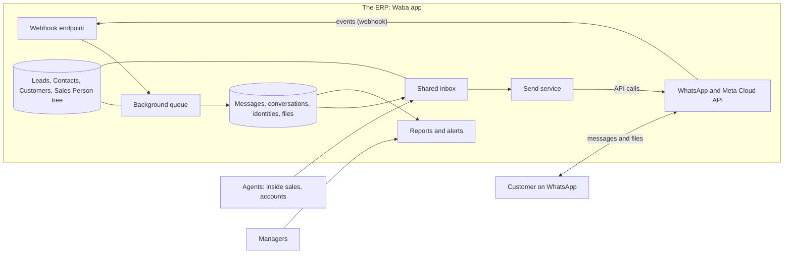
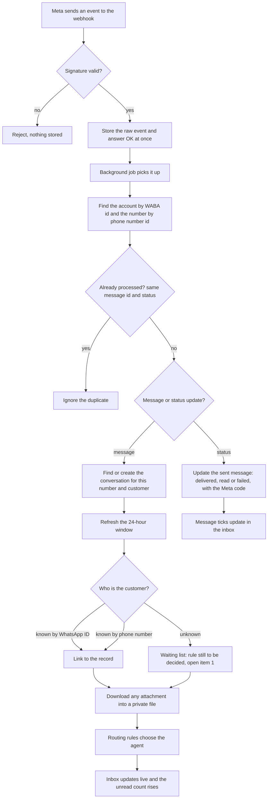
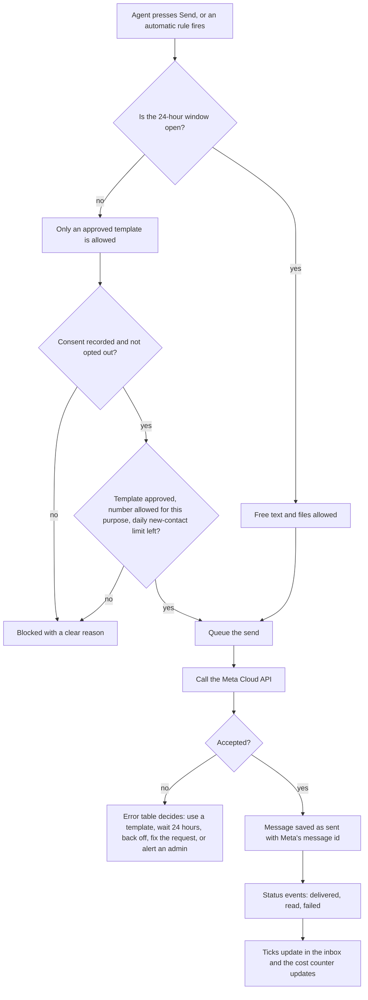
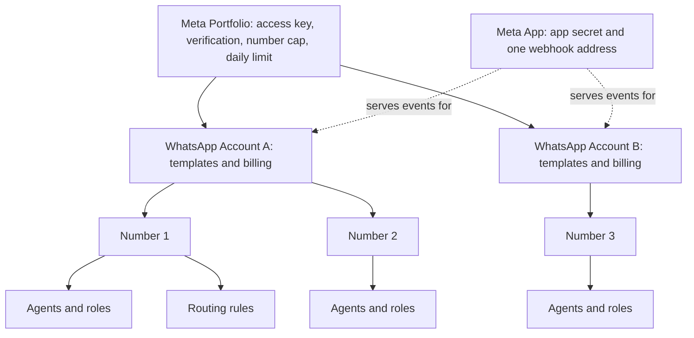
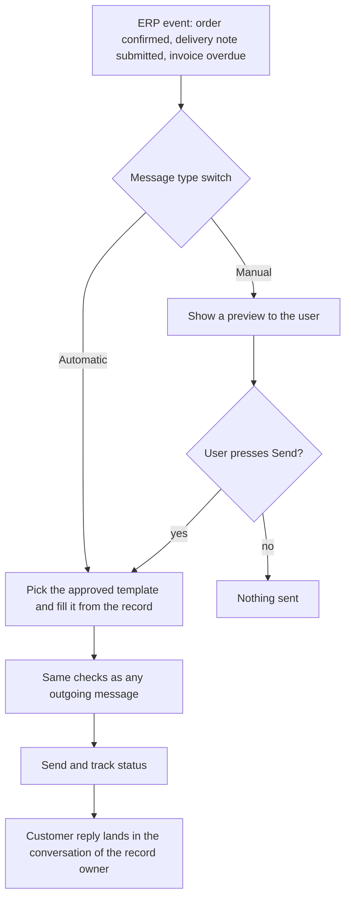
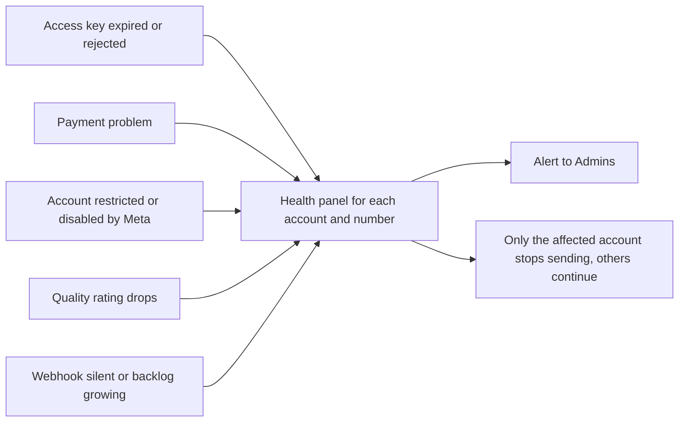
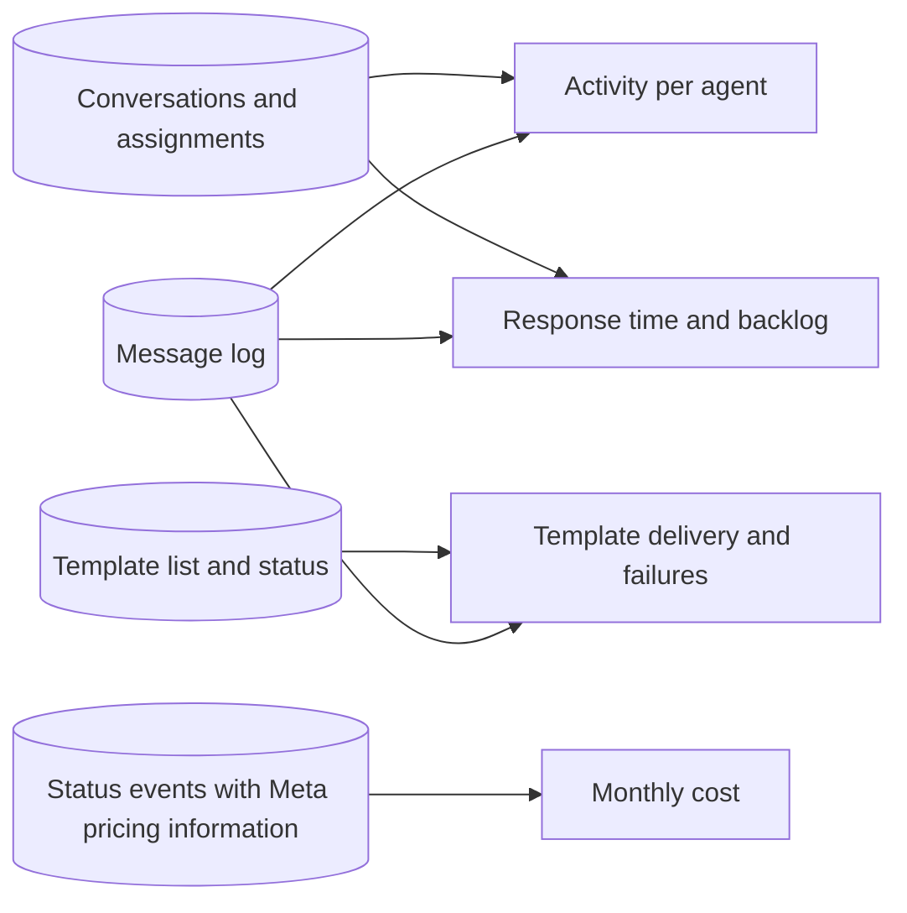

# Waba: how the information moves

**Document 2 of 3: data flow.** Draft for your confirmation, 28 October 2026. Nothing described here has been built yet. Each diagram has a short walk-through underneath.

Documents: [1 Features](01_FEATURES.md) · [2 Data flow](02_DATA_FLOW.md) · [3 User flow](03_USER_FLOW.md)

**How to read the diagrams.** Boxes are steps or places; cylinders are stored data; a diamond is a decision; arrows show the direction information travels. Open items from document 1 are marked where a diagram depends on one.

---

## 1. The big picture

**Walk-through.** A customer and WhatsApp exchange messages. Whenever something happens (a message arrives, a message is delivered, a template is approved) Meta sends an event to one web address in the ERP. The ERP never works on it at once: it saves it and hands it to a background queue, so a busy moment never loses a message. The queue matches the customer to a record in the ERP, saves the message and decides which agent gets it. Agents work in the inbox; whatever they send leaves through the send service to Meta. Managers read the reports built from the saved data.

---

## 2. A customer writes to us (incoming)

**Walk-through.**
1. **Signature.** Meta signs every event with a secret only Meta and the ERP know. An event with a wrong or missing signature is thrown away, so nobody else can feed messages into the ERP.
2. **Saved first.** The raw event is stored before anything else, so if later steps fail it can be replayed. The ERP answers "OK" immediately; otherwise Meta resends for up to 7 days.
3. **Which account and number.** Every event names the WhatsApp account and the number it concerns. With several accounts and numbers this is how the ERP knows where it belongs.
4. **Duplicates.** Meta can send the same event twice. The same message id and status is processed once.
5. **Message or status.** A status event (sent, delivered, read, failed) updates a message we sent. A real message opens or continues a conversation and restarts the 24-hour window.
6. **Who is the customer.** First by WhatsApp's anonymous ID (used when the customer hides their number), then by phone number against Leads, Contacts and Customers. If neither finds anyone the message waits in a list (open item 1).
7. **Attachment.** Files are downloaded at once into private storage, because Meta's links last about five minutes.
8. **Routing.** The number's rules choose the agent (see document 1, section 4.7). The inbox updates without a refresh.

---

## 3. We write to a customer (outgoing)

**Walk-through.**
1. **Window decides what is allowed.** Open: anything. Closed: only a template. The ERP keeps its own clock for each number and customer, because Meta offers no way to ask.
2. **Safety checks for templates:** consent recorded and not opted out (open item 2), template approved by Meta, the number allowed for this purpose, and the daily limit of new contacts not used up. If a check fails the user gets a plain reason.
3. **Queued.** The send happens in the background so the screen stays quick.
4. **If Meta refuses,** a fixed table of Meta's error codes decides what happens: switch to a template (window closed), do not retry for 24 hours (Meta is holding back marketing messages), slow down (too fast), stop (the customer cannot receive), fix the request, or alert an admin (payment problem, restricted account, expired key).
5. **Afterwards,** status events tick the message sent, delivered, read, or failed with the code, and the billing information Meta attaches feeds the cost report.

---

## 4. How the settings are arranged

**Walk-through.** Settings are stored at the level where Meta scopes them. The **portfolio** holds the access key that covers all its accounts, the verification, the cap on numbers and the daily limit shared by all its numbers. The **Meta app** holds the secret that signs events and the single address Meta sends them to; it serves every account it is connected to, and each event says which account it is for. Each **account** owns its templates and its billing. **Numbers** sit under an account; each has its own agents with roles and its own routing rules. Because the levels are linked, any arrangement works: one account for everything, several accounts for several brands, or a second portfolio for a separate company.

---

## 5. Notifications from the ERP

**Walk-through.** Each message type (dispatch update, order update, payment reminder) has a switch. Automatic means the ERP event itself starts the send. Manual means a person sees a preview first. After that both follow the outgoing path in section 3, so consent, approval, limits and the number's purposes are checked either way. If the customer replies to a notification, the reply goes to whoever owns that record (or follows the number's routing rules).

---

## 6. Keeping watch (health and alerts)

**Walk-through.** Several signals feed one health panel: events Meta sends about the account, errors returned when sending, and the ERP's own check of whether messages are still arriving. A serious one raises an alert to Admins immediately. Because each account has its own key, billing and status, a problem on one account does not stop the others.

---

## 7. Where the reports come from

**Walk-through.** Reports are built only from data the ERP already keeps. *Activity per agent* and *response time and backlog* come from the message log and the conversations (who was assigned, when they replied). *Template delivery and failures* come from the status events and the template list. *Monthly cost* uses the pricing information Meta attaches to each delivered message, grouped by category against the free allowance. Managers see only their own hierarchy.

---

## 8. What is stored, where, and who can read it

| Data | Kept where | Who can read it | How long |
|---|---|---|---|
| Access key, app secret, verify token | Encrypted password fields | Admins only | Until changed |
| Raw events from Meta | Event log | Admins | Kept (needed to replay) |
| Messages (text, status, Meta ids) | Message log, linked to the customer record | The assigned agent; the manager of that agent; Admins with a logged reason | **Kept** |
| Attachments | Private files attached to the message | Same as the message | **Kept** |
| Conversations (number, customer, window, agent, status) | Conversation records | Same as the message | **Kept** |
| WhatsApp anonymous IDs and phone pairs | Identity store | Admins and the system | Kept |
| Templates and their status | Template list | Admins and agents allowed to send templates | Kept |
| Notes, reminders, quick replies | Own records | Notes: the conversation's users; quick replies: the team | Kept |
| Consent and opt-out | Fields on the Lead and Contact (design after open item 2) | Staff who can see the record | Kept |
| Audit trail (who read, sent, transferred, exported) | Audit log | Admins | Kept |

**Security in one paragraph.** Events are accepted only with Meta's signature. Keys and secrets are never shown or put in code. Each user's view is limited by the permission rules, including for lists, reports and exports. Meta keeps nothing beyond about 30 days and offers no history, so the ERP's own log is the only record; it is backed up with the rest of the system and everything is kept.

## To confirm

1. That the pictures match how you expect messages to travel.
2. The checks before a template goes out (section 3).
3. Who can read what (section 8), and that everything is kept.
4. That the open items (document 1) stay open until the stated point.
