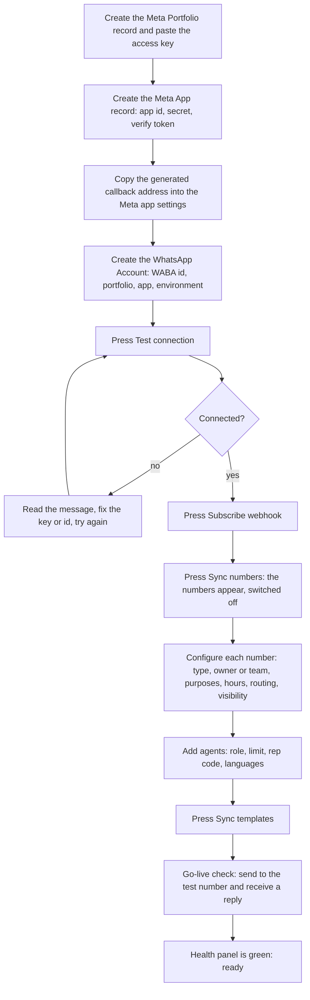
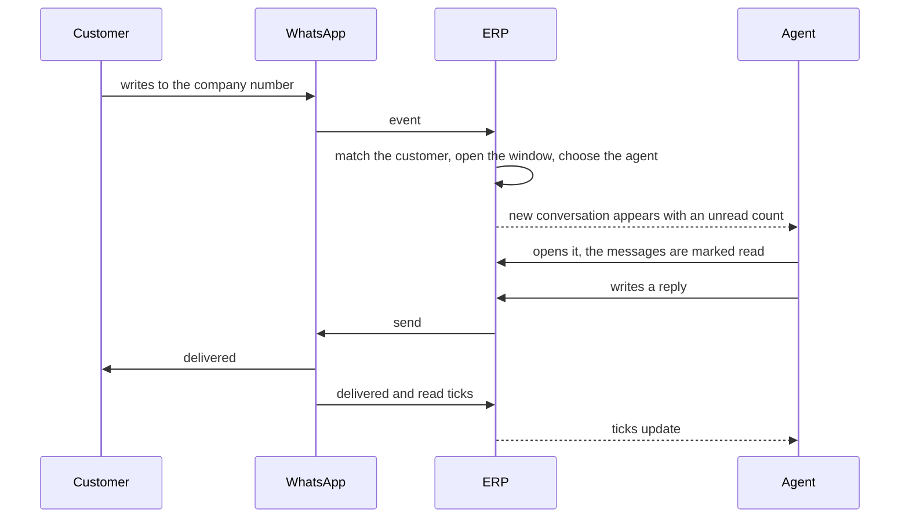
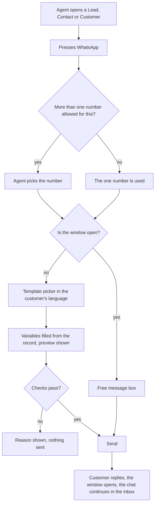
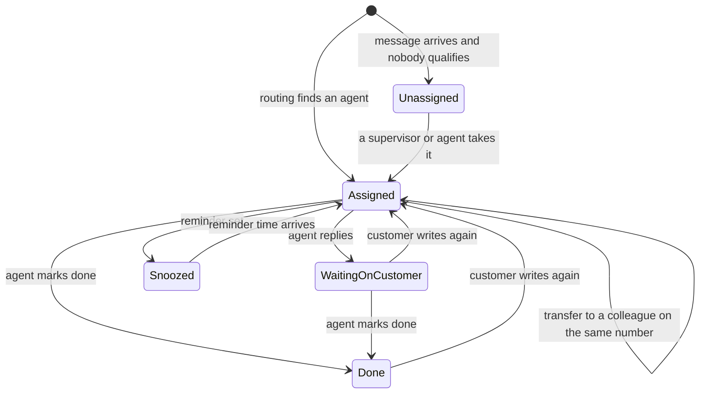
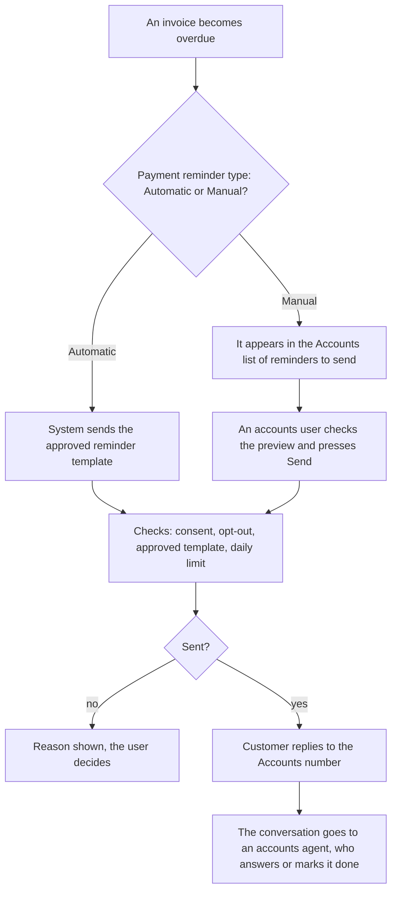
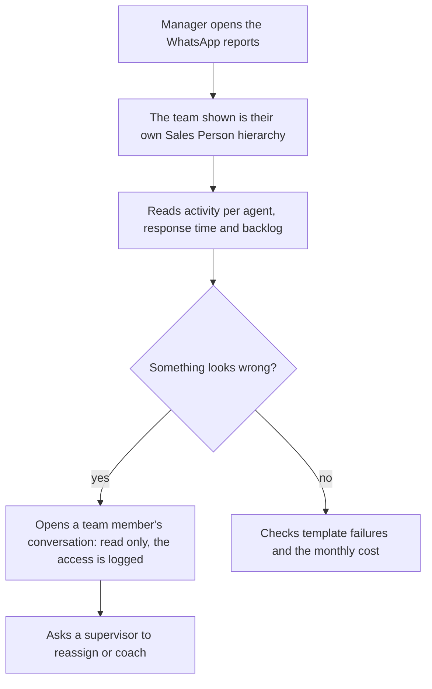
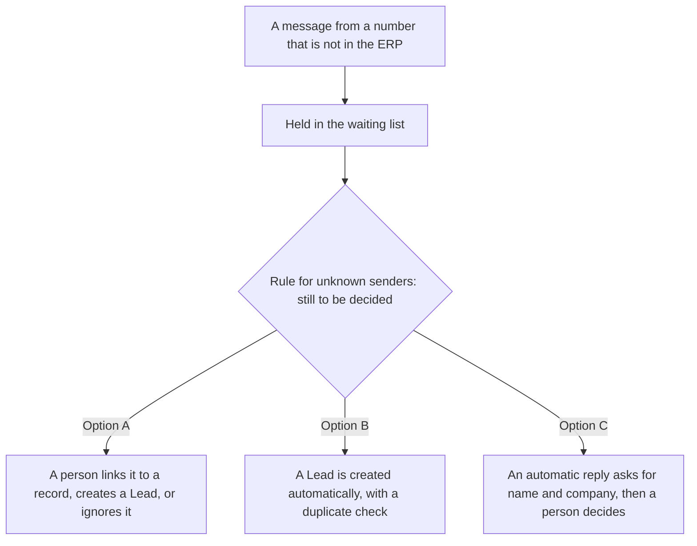
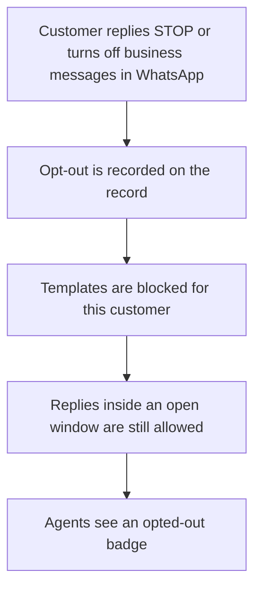
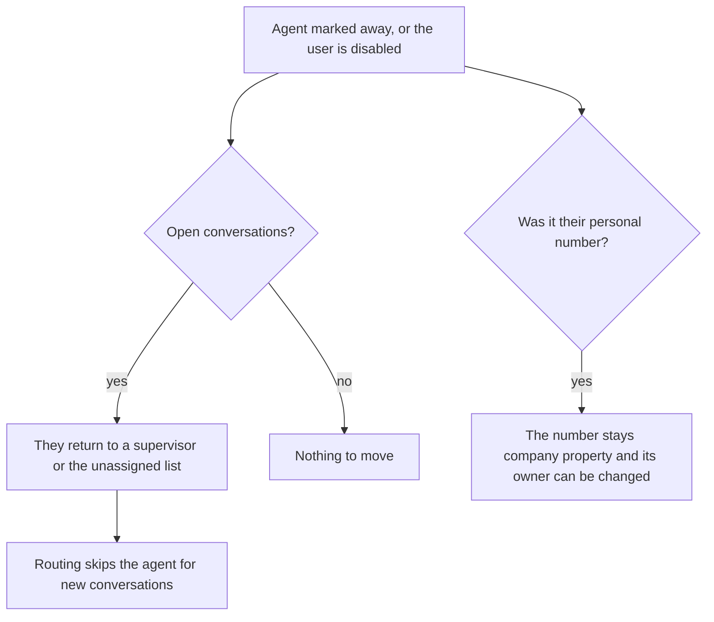

# Waba: what each person does, step by step

**Document 3 of 3: user flows and screen sketches.** Draft for your confirmation, 28 October 2026. Nothing described here has been built yet. Written for the project owner. The sketches show **layout and content only**, not the final look; all names and figures in them are examples.

Documents: [1 Features](01_FEATURES.md) · [2 Data flow](02_DATA_FLOW.md) · [3 User flow](03_USER_FLOW.md)

**Open items from document 1** are marked where a screen or step depends on one: unknown senders (1), where consent is stored (2), attachments (4), the out-of-hours reply (5).

---

## Part A. The journeys

### A1. Admin: connect Meta and set up accounts, numbers and agents



**What the admin sees:** the setup screen (sketch S5) and the number settings (sketch S6). Adding a brand-new number on Meta's side (add, verify by code, register) is done in Meta's tools; the ERP then picks it up with *Sync numbers*.

### A2. Inside sales or telecaller: a customer writes



**What the agent sees:** the inbox (sketch S1). The conversation shows the customer's record, how much of the 24-hour window is left, notes, quick replies and the attachment button.

### A3. Starting a conversation: first contact by template



**What the agent sees:** the WhatsApp button on the record (sketch S3), then the template picker with its checks (sketch S2). Until consent is stored in a place the system can read (open item 2), the *consent* check cannot pass for real customers; test numbers are unaffected.

### A4. Working a conversation: notes, reminders, transfer, done



**Notes** are private to the staff. **Quick replies** are inserted from a list. A **scheduled follow-up** is a message waiting for its time; before it goes out the system re-checks the window, consent and opt-out. A conversation cannot be moved from one number to another: the screen explains that a new template-started conversation from the other number is the only way.

### A5. Accounts and collections: payment reminders



### A6. Manager: oversight



**What the manager sees:** the reports (sketch S7).

### A7. The unusual cases

**A stranger writes (open item 1: the rule is not decided).**



**A customer opts out.**



**An agent goes away or leaves.**



---

## Part B. Screen sketches

These are rough layouts to react to. Real screens will follow the ERP's own look.

### S1. The inbox

```wireframe
+-------------------------------------------------------------------------------------+
| WhatsApp Inbox     Number [North v]   View [My open v]   [Search.........]  [New]   |
+------------------------------+------------------------------------------------------+
| * Rahul Traders         (2)  | Rahul Traders - Lead CRM-LEAD-2026-0123              |
|   Can you send the pri...    | +91 98765 43210      Window open: 18 h 40 m          |
|   10:02 - North              | [Transfer]  [Remind me]  [Mark done]                 |
|                              | ---------------------------------------------------- |
|   Anita Prints               | Customer  10:02                                      |
|   Dispatch update sent       |   Need the price for 20 litre cartons                |
|   Yesterday - North          |                                                      |
|                              |                           Priya  10:05               |
|   Kumar Inks            (1)  |     Sure, sending the quotation   (read)             |
|   Payment reminder           |                           [Quotation.pdf]            |
|   Mon - Accounts             |                                                      |
|                              | Customer  10:20                                      |
| UNASSIGNED (3)               |   Thanks, will confirm tomorrow                      |
|   +91 90000 11111            | ---------------------------------------------------- |
|   +91 90000 22222            | Private note: customer prefers Hindi                 |
|                              | ---------------------------------------------------- |
|                              | [Type a message...              ] [Attach] [Send]    |
|                              | Quick replies: [Greeting] [Price list] [Follow-up]   |
+------------------------------+------------------------------------------------------+
```

Left: the conversations with unread counts and the unassigned list. Right: the conversation, with the customer's record, the **time left in the 24-hour window**, transfer / reminder / done, private notes, the message box, attachments and quick replies. New messages appear without refreshing.

### S2. Sending a template

```wireframe
+----------------------------------------------------------------------------+
| Send a template to Rahul Traders  (+91 98765 43210)                        |
+----------------------------------------------------------------------------+
| Window closed: only approved templates can be sent.                        |
|                                                                            |
| Language [English v]      Category: Utility   (about Rs 0.115 per message) |
|                                                                            |
| Template [quotation_followup v]     Status: Approved     Quality: Green    |
|                                                                            |
| Preview                                                                    |
|   Hello Rahul, we sent quotation QTN-0456 on 24 Oct. Do you have           |
|   any questions? Reply here and we will help.                              |
|                                                                            |
| Variables   name = Rahul (from the Lead)    quotation = QTN-0456  [change] |
|                                                                            |
| Checks   [ok] consent recorded        [ok] not opted out                   |
|          [ok] number allowed for follow-ups                                |
|          [ok] new contacts today: 41 of 250                                |
|                                                                            |
|                                          [Cancel]   [Send template]        |
+----------------------------------------------------------------------------+
```

Shown when the window is closed. It names the checks that must pass; a failed check is shown in plain words and blocks the send.

### S3. The WhatsApp button on a Lead

```wireframe
+-------------------------------------------------------------------------------------+
| Lead CRM-LEAD-2026-0123  Rahul Traders      [Create v]  [WhatsApp]  [Call]          |
+-------------------------------------------------------------------------------------+
| Organisation  Rahul Traders       Status  Open        Owner  Priya                  |
| Mobile        +91 98765 43210     WhatsApp consent   Recorded 12 Oct  (open item 2) |
+-------------------------------------------------------------------------------------+
| WhatsApp on this record                                    [Open in inbox]          |
|   Today 10:20   Customer  Thanks, will confirm tomorrow            North            |
|   Today 10:05   Priya     Sure, sending the quotation   (read)     North            |
|   Today 10:02   Customer  Need the price for 20 litre cartons      North            |
|   Calls, quotations and visits appear in the same timeline, in time order.          |
+-------------------------------------------------------------------------------------+
| Opportunities | Quotations | Calls | Visits | Notes                                 |
+-------------------------------------------------------------------------------------+
```

The same button and timeline appear on a Contact and a Customer. The conversation shows in the record's timeline beside calls, quotations and visits.

### S4. Template library

```wireframe
+--------------------------------------------------------------------------------------+
| Templates     Account [Splashjet v]     [Sync from Meta]   [New template]            |
+--------------------------------------------------------------------------------------+
| Name                  Language  Category   Status    Quality  Last 30 days           |
| quotation_followup    English   Utility    Approved  Green    312                    |
| lead_followup_hi      Hindi     Marketing  Approved  Green    148                    |
| dispatch_update       English   Utility    Approved  Green    205                    |
| payment_reminder      English   Utility    Paused    Yellow   0     paused by Meta   |
| exhibition_invite     English   Marketing  Pending   -        -     waiting for Meta |
+--------------------------------------------------------------------------------------+
```

Shows Meta's approval and quality for each template, and how often it is used. A template Meta has paused cannot be sent.

### S5. Setup: accounts and numbers

```wireframe
+--------------------------------------------------------------------------------+
| WhatsApp Setup                                                                 |
+--------------------------------------------------------------------------------+
| Accounts                                                                       |
| Name          Environment  Portfolio   Key  Payment  Last webhook  Status      |
| Splashjet     Production   Splashjet   OK   OK       2 min ago     Healthy     |
| DuraJet       Production   Splashjet   OK   OK       5 min ago     Healthy     |
| Test account  UAT          Test        OK   -        1 h ago       Healthy     |
| [Add account]  [Test connection]  [Subscribe webhook]  [Sync numbers]          |
+--------------------------------------------------------------------------------+
| Numbers                                                                        |
| Number           Name                 Type      Owner or team  Quality  Agents |
| +91 98xxx 00001  Splashjet North      Shared    North          Green    5      |
| +91 98xxx 00002  Splashjet Accounts   Shared    Accounts       Green    3      |
| +91 98xxx 00003  Splashjet - Priya    Personal  Priya          Green    1      |
+--------------------------------------------------------------------------------+
```

Each account and number shows whether it is healthy. Several accounts can sit here side by side, each with its environment (production or test).

### S6. One number's settings

```wireframe
+-------------------------------------------------------------------------------------------+
| Number +91 98xxx 00001   Splashjet North                                                  |
+-------------------------------------------------------------------------------------------+
| Type [Shared v]   Team [North]   Account [Splashjet v]                                    |
| Used for  [x] Conversations  [x] Documents  [x] Notifications  [ ] Campaigns              |
| Business hours [x] 09:30 to 18:30  Mon-Sat     Auto reply out of hours [ ]  (open item 5) |
| Sticky days [7]    Default max open per agent [20]    Agents see [Own only v]             |
+-------------------------------------------------------------------------------------------+
| Agents                                                                                    |
| User    Role        Available  Max open  Rep code  Languages                              |
| priya   Agent       yes        20        R12       hi, en                                 |
| sunil   Agent       yes        15        R14       hi, mr                                 |
| meera   Supervisor  yes        -         -         en, hi                                 |
+-------------------------------------------------------------------------------------------+
| Routing rules (first match wins)                                                          |
|   1  Stays with its agent      on                                                         |
|   2  Rep code from QR or link  on                                                         |
|   3  Owner of the record       on                                                         |
|   4  Language                  on                                                         |
|   5  Least busy                on                                                         |
|   otherwise: unassigned list, supervisors alerted after [15] min                          |
+-------------------------------------------------------------------------------------------+
```

Type, purposes, hours, how conversations are shared out, which agents work the number and the routing rules, all on one screen.

### S7. Reports

```wireframe
+-------------------------------------------------------------------------------------------+
| Reports   [Activity] [Response time] [Templates] [Monthly cost]                           |
+-------------------------------------------------------------------------------------------+
| Period [This month v]    Team [North v]        (example figures)                          |
+-------------------------------------------------------------------------------------------+
| Activity per agent                                                                        |
| Agent    Conversations  Messages sent  Messages received                                  |
| Priya    124            611            540                                                |
| Sunil    98             402            377                                                |
+-------------------------------------------------------------------------------------------+
| Response time and backlog                                                                 |
| Median first reply 7 min    90 percent within 42 min    Waiting now 6   Oldest 2 h 10 min |
+-------------------------------------------------------------------------------------------+
| Monthly cost (rupees)                                                                     |
| Marketing 1,120 messages   966.67      Utility 3,420 messages   393.30                    |
| Replies beyond the free 1,000   380 messages   43.70           Total  1,403.67            |
+-------------------------------------------------------------------------------------------+
```

Figures are examples. Managers see only their own team.

---

## To confirm

1. Each journey in Part A: is this how the people in your team would actually work?
2. The sketches in Part B: what is missing, what is in the wrong place?
3. That the open items stay open until the point where each screen needs them.
4. When you confirm all three documents in words, building starts with the foundation review.
